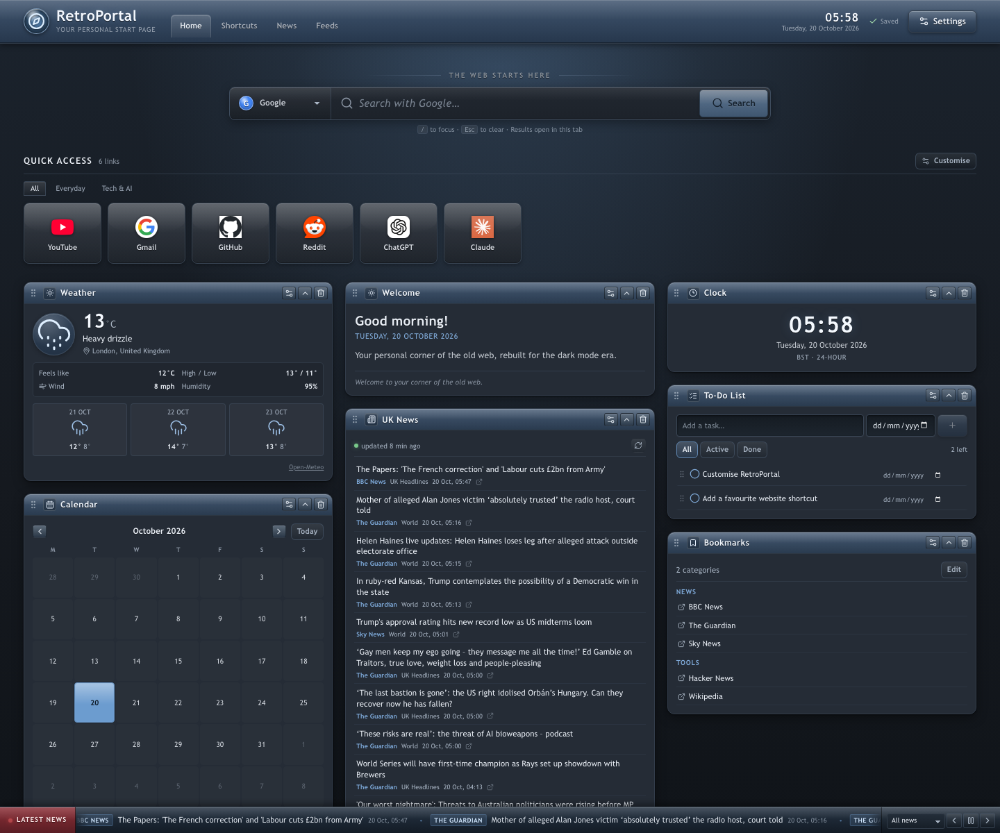
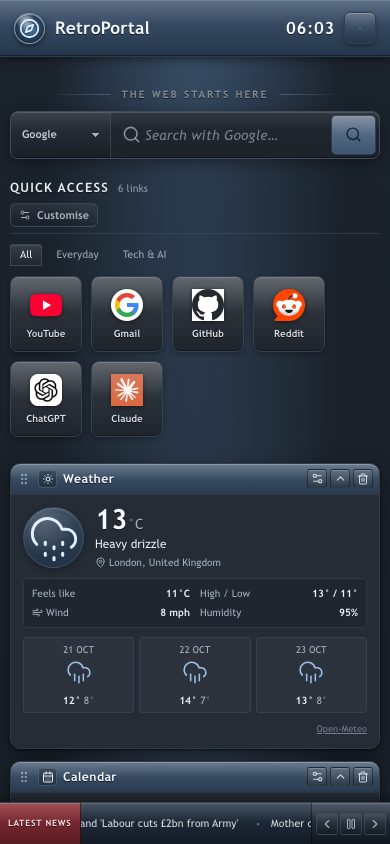

# RetroPortal

A dark-mode, iGoogle-inspired personal homepage for the late-2000s web, rebuilt with React, TypeScript and Vite. It ships as a static GitHub Pages site **and** as a Manifest V3 new-tab extension from the same codebase.

**Live site:** <https://adamstew4649.github.io/retroportal/>



## Features

- **Classic Web 2.0 look** — glossy gradient title bars, bevelled borders, inset highlights, rounded panels and restrained blue steel accents.
- **Central search** — Google, DuckDuckGo, Bing, Brave Search and Startpage, plus custom HTTPS engines. Queries are encoded safely, history is optional, `/` focuses the search box and results can open in a new tab.
- **Customisable shortcuts** — add, edit, delete, reorder, categorise and choose icons. Safe URL validation blocks `javascript:` and other unsafe protocols.
- **Ten draggable widget types, multiple instances** — Welcome, Clock, Weather, Fish, Calendar, Notes, To-do, RSS, UK News and Bookmarks. The default layout uses nine; Fish is available from **Settings → Layout**. Add another Clock, RSS reader or News panel at any time; each copy has its own settings and, for collection widgets, its own notes, tasks, events or bookmarks. Widgets can be collapsed, renamed, removed and reordered between columns.
- **Live UK weather** — Open-Meteo current conditions and a three-day forecast for London by default, with manual location search. No API key or geolocation prompt.
- **A living fish tank** — an original canvas aquarium inspired by the classic iGoogle Fish gadget. Fish follow your pointer, you click the water to drop food, and they swim over to eat it. Choose the number of fish, individual colours, water theme, current speed, bubbles, plants and tank height.
- **Real news aggregation** — a scheduled GitHub Action retrieves BBC, Guardian and Sky RSS/Atom feeds, de-duplicates articles and publishes a static JSON dataset. The site never fabricates headlines and labels stale data as cached.
- **Scrolling UK news ticker** — real headlines with publisher labels, category filter, pause/resume, previous/next, adjustable speed, hover pause and `prefers-reduced-motion` support.
- **Full customisation** — five built-in themes plus custom colours, gradient/colour/image backgrounds, font presets, size, radius, shadows, density, search-bar style, columns and gap.
- **Local-first persistence** — versioned `localStorage` data plus IndexedDB for uploaded backgrounds. JSON export/import includes shortcuts, layouts, notes, tasks, events, feeds and preferences.
- **Responsive and accessible** — three columns on desktop, two on tablet and one on mobile; keyboard-friendly drag controls, labelled icon buttons, visible focus states and reduced-motion handling.
- **Two deployment modes** — GitHub Pages and a bundled Manifest V3 extension with an optional hosted redirect.



## Tech stack

| Area | Choice |
| --- | --- |
| UI | React 19, TypeScript 5.9 |
| Build | Vite 7 |
| Drag and drop | `@dnd-kit/core` and `@dnd-kit/sortable` |
| Icons | `lucide-react` |
| Tests | Vitest, jsdom, Testing Library |
| News generation | Node.js script using `fast-xml-parser` |
| Hosting | GitHub Pages via GitHub Actions |
| Extension | Chrome/Chromium Manifest V3 |

No backend, database, API key or paid service is required for the core experience.

## Quick start

Requirements: Node.js 22 (see `.nvmrc`) and npm.

```bash
npm ci
npm run dev
```

Open <http://localhost:5173>. The production build works from any subdirectory because Vite uses relative asset paths (`base: './'`).

### Scripts

| Command | Purpose |
| --- | --- |
| `npm run dev` | Start the Vite development server. |
| `npm run build` | Type-check and create the production site in `dist/`. |
| `npm run preview` | Preview the production build locally. |
| `npm run typecheck` | Run TypeScript without emitting files. |
| `npm test` | Run the Vitest suite once. |
| `npm run test:watch` | Run tests in watch mode. |
| `npm run news` | Fetch configured feeds and regenerate `public/data/news.json` and `public/data/feeds/*.json`. |
| `npm run icons` | Regenerate PWA and extension PNG icons. |
| `npm run build:extension` | Build the web app and package it into `extension/dist/`. |
| `npm run verify` | Type-check, test, build and package the extension. |

## Project structure

```text
src/
  components/     Header, search, shortcuts, dashboard, widget frame, ticker, settings
  widgets/        Widget implementations, manifests, registry and instance lifecycle
  state/          Portal, news and toast providers
  services/       Search, weather, RSS, news, storage and extension bridge
  themes/         Built-in theme presets
  types/          Shared TypeScript schema
  utils/          URL, date, text and ID helpers
  config/         Defaults, news categories and storage keys
scripts/
  update-news.mjs       RSS/Atom aggregation
  build-extension.mjs   Extension packaging and validation
  make-icons.mjs        PNG icon generation
extension/        Manifest, options page and packaging output
tests/            Search, RSS, storage migration, widget lifecycle and UI tests
public/data/      Generated news and per-feed snapshots
docs/             Screenshots and deployment guide
```

### Widget manifests and instances

Each widget folder contains a `manifest.ts` that declares its type, title, description, icon, component, settings panel and default settings. `src/widgets/registry.tsx` discovers those manifests at build time with Vite's eager `import.meta.glob`, so there is no central import list to edit. The dashboard, Settings → Layout catalogue, per-widget settings and instance lifecycle all read from the same manifests.

Every widget type can be added more than once. Settings are keyed by widget instance id rather than type, so two RSS widgets can follow different feeds and two clocks can show different time zones. Notes, tasks, calendar events and bookmark categories also carry a `widgetId`; each collection widget is therefore an independent notebook, task list, calendar or bookmark shelf. Removing a widget deletes its own settings and content after a confirmation that names the affected item count.

To add a new widget type:

1. Add its type and settings shape to `src/types/index.ts` (`WIDGET_TYPES` and `WidgetSettingsMap`).
2. Add its default settings factory to `src/widgets/defaults.ts`.
3. Create `src/widgets/<Name>/` with the widget and settings components plus a `manifest.ts` that exports a `WidgetManifest`.
4. Restart the dev server or run a build. The glob discovers the manifest automatically; storage validation accepts the new type through `WIDGET_TYPES`.

No dashboard, settings-list or registry import needs editing. The manifest `order` field controls its position in the add-widget catalogue.

## How the data works

### Persistence

| Data | Storage |
| --- | --- |
| Settings, layout, widget instances, notes, tasks, events, bookmarks, search history | `localStorage` key `retroportal:data:v2` |
| Last successful news dataset | `localStorage` key `retroportal:news-cache:v1` |
| Weather cache | `localStorage` key `retroportal:weather-cache:v1` |
| RSS results | `localStorage` keys prefixed `retroportal:rss-cache:v1:` |
| Uploaded background image | IndexedDB database `retroportal`, store `backgrounds` |

The data schema is versioned (`CURRENT_DATA_VERSION` in `src/config/defaults.ts`). Imported or stored data passes through `src/services/storage/validate.ts`, which clamps values, strips unsafe URLs, drops unknown widget types and reconciles widget positions. Existing v1 data stored under `retroportal:data:v1` is migrated automatically: type-keyed settings move onto widget instance ids, global notes/tasks/events/bookmarks are assigned to the first matching widget, and the upgraded v2 record replaces the old key.

**Limitation:** persistence is per browser and per device. There is no account or cross-device sync. Use **Settings → Backup & data** to move a portal between browsers.

### Backup and reset

**Settings → Backup & data** exports a JSON envelope containing the full `PortalData` object and, when present, an embedded background image under the 6 MB limit. Imports are validated before use. Reset actions cover the whole portal and individual sections.

### News aggregation

`scripts/update-news.mjs` fetches 14 public RSS/Atom feeds, normalises titles, strips HTML, removes tracking parameters, rejects unsafe URLs, de-duplicates by URL and normalised title, sorts newest first, and writes:

- `public/data/news.json` — the combined news dataset used by the news widget and ticker.
- `public/data/feeds/*.json` — per-feed snapshots used by the default RSS widget.

The homepage requests these relative files at runtime. Browser JavaScript does **not** fetch the publisher feeds directly, which avoids most CORS restrictions. Custom RSS feeds still attempt a direct browser fetch and show an explanatory error plus cached items when a publisher blocks cross-origin requests.

The workflow in `.github/workflows/update-news.yml` runs every 30 minutes and on manual dispatch. It commits changed data to `main` and then explicitly dispatches the Pages deployment. A commit pushed with the default `GITHUB_TOKEN` does not start other workflows on its own, so the explicit dispatch is required. GitHub scheduled workflows can be delayed during busy periods and are not guaranteed to run to the minute. If a run fails, the last successfully committed dataset remains published.

The interface always shows the dataset's update time. When a refresh fails, cached headlines are marked as stale rather than presented as live. Attribution stays with the original publisher and every headline links to the source article.

### Weather

Weather uses Open-Meteo's free forecast API (no key). Requests are cached briefly in `localStorage`; failures leave the previous reading visible with a clear error state. Location search uses Open-Meteo's geocoding endpoint. The browser never asks for precise geolocation permission.

## Customisation

- **Appearance:** theme presets, individual colours, gradient or uploaded image background, retro/modern fonts, font size, corner radius, shadows, density and search-bar style.
- **Layout:** one to four columns, gap size, add additional widget instances, remove widgets, reset positions, restore the default set, and drag handles. On narrow screens columns collapse to one while preserving order.
- **Search:** default engine, custom HTTPS engine templates containing `%s`, history on/off, and new-tab preference.
- **News:** dataset endpoint, default categories, sources, article count, refresh interval, ticker on/off, speed and ticker categories.
- **Widgets:** per-instance settings and custom names for clock format/time zone, weather location/units, fish count/colours/water/speed, RSS feeds and count, news categories/sources/count, note colours and taller layouts. Collection widgets keep separate content per instance.

## Accessibility and security

- Semantic landmarks, labelled controls, visible focus outlines and a skip link.
- Keyboard-accessible sortable widgets via `@dnd-kit`'s keyboard sensor; every widget also has move-left/right buttons in its menu.
- Ticker animation pauses on hover and is disabled for `prefers-reduced-motion`; a static, manually navigable list remains available.
- Article and feed HTML is stripped to plain text; URLs are restricted to HTTP(S); background images accept only raster data URLs.
- Extension pages use an explicit CSP with no inline scripts and request only the `storage` permission.
- No secrets, analytics, tracking scripts or third-party CORS proxies are included.

## Testing

```bash
npm test
npm run typecheck
```

The automated suite covers search URL construction and template validation, RSS/Atom parsing, de-duplication, unsafe link rejection, snapshot parsing, backup round-trips, v1→v2 storage migration, layout reconciliation, per-instance settings and content, fish colour/count validation, widget add/remove/restore lifecycle, manifest discovery, news dataset validation, news-provider filtering and error states, extension hosted-URL validation, and core search-bar interactions. See the manual QA checklist at the end of this document.

## Deploy to GitHub Pages

See [docs/DEPLOYMENT.md](docs/DEPLOYMENT.md) for the full walkthrough. In short:

1. Create a repository (for example `retroportal`) and push this project to `main`.
2. In **Settings → Pages**, set **Source** to **GitHub Actions**.
3. Ensure Actions has **Read and write permissions** if you want the news workflow to commit updates (**Settings → Actions → General → Workflow permissions**).
4. Push to `main`. `.github/workflows/deploy.yml` type-checks, tests, builds, packages the extension, uploads the Pages artifact and deploys it.
5. The site is available at `https://USERNAME.github.io/REPOSITORY/`.

Relative asset paths support repository subdirectories and custom domains without changing the build. To use a custom domain, configure it in **Settings → Pages**; no Vite base change is required.

## Browser extension

```bash
npm run build:extension
```

Then open `chrome://extensions`, enable **Developer mode**, choose **Load unpacked**, and select `extension/dist`. Open a new tab. The extension runs the bundled React build locally and does not inject scripts into the hosted site.

Two modes are available from the extension's options page:

| Mode | Behaviour |
| --- | --- |
| **Bundled local** (default) | Opens the app from files inside the extension. Interface and local widgets work offline; weather and refreshed news need a connection. Updates arrive when a new extension build is installed. |
| **Hosted** | Redirects new tabs to a configured GitHub Pages URL (or `http://localhost` for development). Interface changes deploy immediately, but the page needs a connection and is not available offline. |

Preferences and data in the two modes are separate: the hosted site uses the site's origin storage, while bundled mode uses the extension origin. See [extension/README.md](extension/README.md) for install, update and removal steps.

## Troubleshooting

| Problem | Fix |
| --- | --- |
| Pages build fails on `npm ci` | Ensure `package-lock.json` is committed and Node 22 is used. |
| Site loads but assets 404 under a repository path | Keep `base: './'` in `vite.config.ts` and use relative asset URLs. |
| News widget says no headlines | Run `npm run news`, confirm `public/data/news.json` exists, then check the dataset endpoint in **Settings → News**. |
| A custom RSS feed shows a CORS error | Most publishers block browser cross-origin requests. Use the bundled snapshots or add the feed to `scripts/update-news.mjs` so the Action can publish it. |
| News workflow commits fail | Grant **Read and write permissions** under **Settings → Actions → General**. |
| Scheduled news is late | GitHub cron runs can be delayed; use **Actions → Update UK news dataset → Run workflow** to refresh manually. |
| Extension looks outdated | Rebuild with `npm run build:extension` and reload it on `chrome://extensions`. |
| Uploaded background missing after import | Backgrounds larger than the export limit are not embedded; re-upload the image locally. |
| Storage full | Export a backup, remove uploaded backgrounds or old feeds, then reset the relevant section. |

## Testing and manual QA

Automated tests cover parsing, storage and search behaviour. For visual and browser-only checks:

1. Run `npm run dev` and confirm the desktop layout uses three columns at widths above 1180 px.
2. Resize to 700–1180 px (two columns) and below 700 px (one column). Confirm there is no horizontal scroll and the ticker controls remain usable.
3. Search with each engine; verify the URL is encoded and the result opens according to the new-tab preference.
4. Add, edit, reorder and delete a shortcut; reload and confirm persistence.
5. Drag a widget between columns using a mouse and using the keyboard sensor; collapse, rename and remove widgets.
6. Add a second Clock and a second RSS widget from **Settings → Layout**. Give them different time zones/feeds, reload, and confirm both keep independent settings and that removing one leaves the other intact.
7. Add Fish from **Settings → Layout**, move the pointer over the tank and click the water to drop food. Confirm the fish follow the pointer, eat the food and that a second Fish widget keeps its own colours, water and tank height.
8. Add a note, task, event and bookmark to a second collection widget. Confirm each widget shows only its own content, then remove one and check the confirmation names the affected item count.
9. Open **Settings**, switch themes, change colours, upload a background, export a backup, reset, then re-import the backup.
10. With the ticker visible, test pause, previous/next, speed changes, category filtering and hover pause. Enable reduced motion at the OS level and confirm the static fallback.
11. Disable the network and confirm cached/local sections still render with a clear offline state.
12. Build the extension, load it unpacked, and confirm a new tab opens RetroPortal. Test both bundled and hosted modes in the options page.

## Acknowledgements

- Weather data by [Open-Meteo](https://open-meteo.com/).
- Headlines and feed data remain the property of their publishers (BBC News, The Guardian and Sky News); RetroPortal links to the original articles and does not republish full content.
- The Fish widget is an original canvas implementation inspired by [aBowman's classic iGoogle Fish gadget](https://www.abowman.com/gadgets/fish/). No original Flash assets or code are used.
- Icons by [Lucide](https://lucide.dev/).
